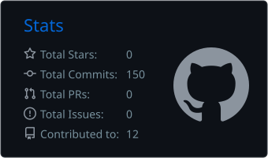
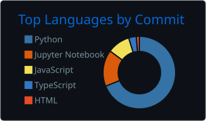

# Hey, I'm Atharva 👋

Developer from India. Most of my time goes into ML, data pipelines and backend work, and lately a lot of it has gone into making things run in real time.

**Right now I'm building [EduStream](https://github.com/AthSri0507?tab=repositories)**: it transcribes lectures live and turns them into notes, with Apache Kafka in the middle moving everything along.

**Currently learning:** deep learning, computer vision, stream processing, system design and distributed systems.

**Open to collaborating on:** ML/AI, computer vision, robotics, embedded systems, or any open-source project that sounds fun.

**Reach me at:** [atharvahmv@gmail.com](mailto:atharvahmv@gmail.com)

---

### 🛠️ Tech I work with

**Languages**&nbsp;

&nbsp;&nbsp;&nbsp;&nbsp;
**Frontend**&nbsp;

**Backend**&nbsp;

&nbsp;&nbsp;&nbsp;&nbsp;
**Databases**&nbsp;

**ML / AI**&nbsp;

&nbsp;&nbsp;&nbsp;&nbsp;
**Data**&nbsp;

**Big Data & Streaming**&nbsp;

&nbsp;&nbsp;&nbsp;&nbsp;
**DevOps & Tools**&nbsp;

---

### 📊 GitHub stats

  
  

  <picture>
    <source media="(prefers-color-scheme: dark)" srcset="https://raw.githubusercontent.com/AthSri0507/AthSri0507/output/snake-dark.svg" />
    <source media="(prefers-color-scheme: light)" srcset="https://raw.githubusercontent.com/AthSri0507/AthSri0507/output/snake.svg" />
    
  </picture>

  
  
  

